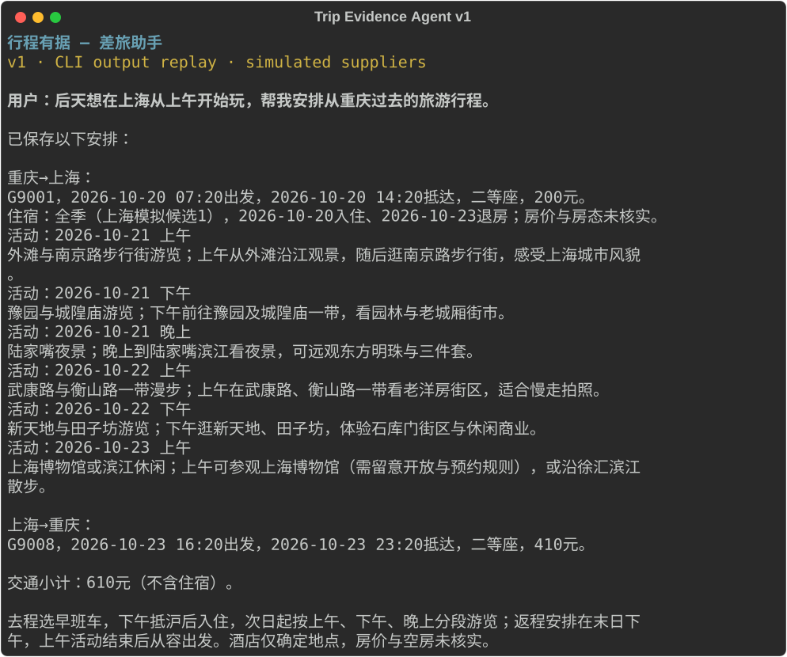
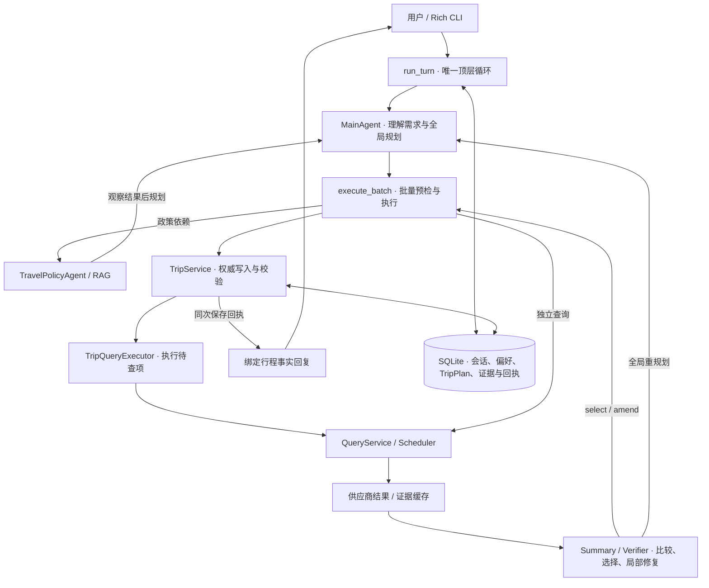

# 行程有据 · Trip Evidence Agent v1

**一个以查询证据为依据、支持持续修改的高铁差旅规划 Agent。**

采用 **ReAct + Workflow + Harness + Verifier** 混合架构：大模型理解需求、规划和比较方案；程序批量执行工具、校验证据与约束；TripPlan 保存可追踪的行程，提供 Rich 命令行交互。

**版本说明：** 本文及对应代码为 **v1**。GitHub 原有版本已完整保存在 [`v0` 分支](https://github.com/yzy703050-oss/trip-evidence-agent/tree/v0)，对应提交 [`d017f6b`](https://github.com/yzy703050-oss/trip-evidence-agent/commit/d017f6ba9c6e587ffa5bcd7f041b75962f129dd9)。v1 通过独立 PR 提交，保留 v0 历史。[版本迁移说明](docs/releases/v1.md)

## 1. Project Overview · 项目简介

差旅规划需要同时处理自然语言要求、交通候选、住宿、企业政策与用户偏好。一次查询成功不代表行程合理，模型写出计划也不代表计划已正确保存。

本项目把开放决策交给模型，把确定性执行与数据规则交给程序：规划依据对应证据，修改保留无关成果，恢复不重放已完成写入，评测同时检查运行正确性、规划合理性与成本。

### v0 → v1

| 维度 | v0 存档实现 | v1 当前实现 |
| --- | --- | --- |
| 顶层执行 | ExecutionHarness / WorkflowRunner | run_turn 唯一顶层循环 |
| 决策协议 | 主 Agent 返回结构化流程决定 | 原生 Function Calling，支持批量 tool_calls |
| 规划评估 | Runner 协调主模型规划与选择 | Main 完整初案，工具后 Summary/Verifier 评估及局部修复 |
| 查询执行 | 原流程绑定和调度查询 | TripQueryExecutor 自动执行待查项，与独立查询复用证据 |
| 状态边界 | Runner 协调流程和 TripPlan | ExecutionState 管运行，TripService 管业务版本与生命周期 |
| 回复事实 | 按查询引用重建并汇总 | reply 绑定同次保存回执，避免重新抄写车次、时间与价格 |

多段行程、政策、SQLite、长期偏好和历史恢复是在既有项目上保留与演进的能力，并非 v1 重新开发。

## 2. Features · 核心功能

| 功能 | 当前能力 |
| --- | --- |
| 高铁差旅规划 | 估算交通占用，统筹去返程、住宿与活动；默认高铁，明确其他车种按用户要求 |
| 多城市与多任务 | 一个 TripPlan 包含多个有序旅段，比较各段候选并选择交通、住宿 |
| 持续对话修改 | 调整活动、酒店、日期或路线；联动受影响的住宿与查询，复用有效成果 |
| 企业政策 | 本地资料检索、条款理解、带来源和适用性的约束；缺资料如实保留缺口 |
| 用户记忆 | SQLite 保存明确偏好、撤回保护及低频历史总结；偏好与硬要求分开 |
| 独立查询 | 铁路、酒店地点、天气和网页查询，不重复提交 TripPlan 已覆盖的查询 |
| 证据与版本 | 校验引用、展示记录、有效期、归属及版本，条件变化使相关绑定失效 |
| 执行可靠性 | 批量预检、独立查询并发、缓存、预算、重试、熔断及中断恢复 |

**能力边界：** 当前没有攻略检索工具，活动由模型结合需求与常识提出建议，不保证实时开放或预约。酒店接口提供地点，不能证明房价与空房。项目不执行购票、订房、支付或退改签。

## 3. Demo · 演示与截图

```text
后天想在上海从上午开始玩，帮我安排从重庆过去的旅游行程。
```

下面是一次真实模型评测输出的 **CLI 回放渲染图**。测试时间固定为 2026-10-19，交通、酒店和政策为模拟供应商，资源不代表真实可购买车次或房间。



模型安排前一天抵沪，保留后天上午游玩，联动三晚住宿与返程，经初案、工具查询和 Verifier 选择两次模型调用完成。[脱敏示例](docs/demo/v1-planning-example.json)

持续修改与偏好示例：

```text
把这次上海行程已建议的散步改成同日参观博物馆，其他安排保持原样，保存后告诉我。
把返程顺延一天，需要的住宿也一起调整，其他安排保持原样。
后天上午在上海开会，帮我从重庆安排交通和酒店，只安排我提到的会议。
以后出差尽量选高铁，酒店优先考虑全季。
```

纯活动修改可以直接保存并复用交通、酒店；日期变化会重新处理受影响项，修改不能只写在解释文字里。

## 4. Architecture · 系统架构



| 职责 | 实际实现 |
| --- | --- |
| Main 规划与原生工具决策 | [agents/main.py](trip_assistant/agents/main.py)、分阶段提示 |
| 编排、调度与批量执行 | [runtime/loop.py](trip_assistant/runtime/loop.py)、[runtime/execution.py](trip_assistant/runtime/execution.py)、Scheduler |
| Harness 确定性规则 | 工具契约、整批预检、[TripService](trip_assistant/trips/service.py) 和 trips 校验模块 |
| 自动查询 | [trips/query_execution.py](trip_assistant/trips/query_execution.py)、QueryService |
| Summary / Verifier | 同一主模型的评估阶段，使用独立职责提示及受限工具，不另起顶层循环 |
| 事实展示与持久化 | [presentation/trip_reply.py](trip_assistant/presentation/trip_reply.py)、SQLite repositories |

普通独立查询由 SUMMARY_PROMPT 总结，不默认创建或修改 TripPlan。政策、历史定位等规划依赖完成后，由原循环继续 Main。

## 5. Key Designs · 核心工程设计

### 5.1 Hybrid Orchestration

**模型决定查什么、怎么规划；程序决定合法动作怎样执行。**

- Main 尽量同次完成估算、条件、全部旅段、活动及查询地图；不意味着整个用户请求只调用一次模型。
- write_trip.propose 保存草案，TripQueryExecutor 自动执行待查项，不再独立 query 重复提交。
- 政策存在真实依赖时先取得并观察；其余参数已知的独立工具可同批提出、并行执行。
- Verifier 对照原请求、完整计划、偏好、政策、候选及版本评估；局部直接修复，全局策略变化才交回 Main。
- 相同规范化请求复用有效原始证据，按当前约束与排序重新投影；连续无真实进展时有界停止，版本自增不算进展。

历史整轮单次生成实验已退役，统一使用 Main→工具→Verifier。旧配置 false 兼容，true 会明确报错；旧实验未完成轮次不重放，已保存行程可通过新请求继续调整。

### 5.2 Evidence Validation

通过 query_id + result_revision + candidate_id 引用真实候选。程序检查归属、是否已展示、有效期、条件绑定及版本，再重建所选事实。

候选先按硬条件过滤，再按模型显式排序，每次展示 Top5。软条件不冒充硬过滤；完整证据保留缓存，当前不向模型开放翻页。过期结果按有效原查询条件刷新，失败保持为缺口。

最终 select/amend 同次提交 reply 引用，车次、时间、票价、住宿和活动由实际保存回执生成；模型解释取舍。引用绑定能减少事实抄写错误，不能证明所有规划语义合理。

接口失败不等于市场无资源，酒店地点不等于房价或空房，保存成功不等于出票或预订。

### 5.3 TripPlan State Management

TripService 是权威业务写入口。模型提出 proposal 或补丁，程序生成身份、版本与状态，管理 Task、查询容器、证据绑定及依赖失效。

| 状态层 | 典型状态 | 职责 |
| --- | --- | --- |
| TripPlan | running / completed | 当前业务版本是否仍需处理 |
| Task | pending / draft / validated | 各旅段查询、选择及校验进度 |
| 查询容器 | empty / ready / failed | 当前查询绑定，ready 不保证存在候选 |
| ExecutionState / execution job | 决策、执行、校验、修复、停止与恢复 | 工具、预算和重试进度，与业务状态分开 |

constraint_snapshot 保护硬条件与活动；来源说明条件从何而来，hard/soft 说明是否可调整，用户偏好不会自动升级为硬要求。

局部修改保留无关安排，日期等条件改变后相关绑定失效。版本检查与 SQLite 事务保护原子保存，工作草案和上次提交方案分别维护。用户可继续修改，不以模型自评作为提交口令。

状态机管理数据生命周期，不按业务关键词替模型规划或决定工具。粗时段部分重叠交模型判断；确定的引用、权限和时间冲突由程序保护。

### 5.4 Memory & Multi-Agent

- **用户记忆**：明确偏好直接增改撤回，必要摘要注入上下文，不增加详细偏好按需读取入口。
- **历史总结**：符合条件的已保存行程低频增量分析，明确偏好与撤回保护优先，避免每轮重分析。
- **政策 Agent**：独立临时上下文处理 RAG 证据、条款、来源及适用性，不持有第二个业务循环。
- **偏好分析 Agent**：只总结长期偏好，不操作 TripPlan。Main 与 Verifier 是主模型不同阶段职责。
- **上下文与恢复**：默认 20,000 Token 预算，80% 触发旧完整轮次压缩；保留活动轮、工具配对和原审计。回执和检查点持久化，已完成写入不重放，恢复沿用本轮已消耗预算。

## 6. Quick Start · 快速运行

Python **3.11**。在仓库根目录运行。PR 合并前先切换到 codex/v1-native-agent-readme 取得 v1；合并后使用 main，旧版可从 v0 分支检出。

```powershell
git clone https://github.com/yzy703050-oss/trip-evidence-agent.git
cd trip-evidence-agent
# PR 合并前：git switch codex/v1-native-agent-readme
python -m venv .venv
.venv/Scripts/python.exe -m pip install -r requirements.txt
Copy-Item .env.example .env
.venv/Scripts/python.exe cli.py
```

macOS / Linux 改用 .venv/bin/python，配置复制使用 cp .env.example .env。已有 .env 时保留原文件。

| 配置项 | 说明 |
| --- | --- |
| LLM_API_KEY / DEEPSEEK_API_KEY | 模型密钥，二者选用，仅存本地 .env |
| LLM_MODEL / LLM_BASE_URL | OpenAI 兼容模型名称及地址，默认值见 [.env.example](.env.example) |
| JUHE_TRAIN_API_KEY | 铁路查询授权密钥 |
| AMAP_API_KEY | 高德酒店地点搜索，不提供房价或空房 |
| PLANNING_ROUNDS | 8，分阶段规划、评估与有限修复 |
| LLM_MAX_TOKENS / MEMORY_CONTEXT_BUDGET_TOKENS | 默认输出上限 8192 / 上下文预算 20000，思考关闭 |
| LLM_INPUT_USD_PER_1M_TOKENS / LLM_OUTPUT_USD_PER_1M_TOKENS | 可选费用估算单价，未知费用不记零 |

缺授权或查询失败时如实返回不可用，不自动拿模拟数据代替真实供应商。模拟数据仅用于明确测试入口。

首次启动输入用户 ID 和长期居住城市。常用命令：

| 命令 | 用途 |
| --- | --- |
| help / status | 帮助与当前会话状态 |
| preferences / preferences set 类型 值 / preferences delete 类型 | 查看、设置和撤回偏好 |
| history / resume | 行程摘要、选择历史会话恢复 |
| clear | 清空模型上下文，保留偏好、行程和原始审计 |
| health / exit | 检查模型服务、退出 |

```powershell
.venv/Scripts/python.exe cli.py --help
.venv/Scripts/python.exe cli.py health
```

**可选政策知识库：** 资料位于 .claude/skills/ask-question/data/documents/，初始化读取 .txt。默认嵌入模型路径为 data/models/bge-small-zh-v1.5，可用 RAG_EMBEDDING_MODEL 配置本地路径。准备模型与适用资料后执行（会写知识库）：

```powershell
python .claude/skills/ask-question/script/init_knowledge_base.py
```

Windows 中文路径环境可在初始化及运行前设置相同路径：`$env:V0_RAG_DB_DIR = 'C:\trip-evidence-rag'`。变量名保留兼容，不代表应用版本为 v0；政策资料缺失只能提供合规待核实草案。

## 7. Testing & Evaluation · 测试与评测

### 离线测试

```powershell
python -m pip install pytest pytest-asyncio jsonschema ruff
python -m pytest -q tests
python -m compileall -q trip_assistant cli.py
python -m ruff check trip_assistant cli.py
python -m evals.native_runner --output .test-tmp/native-eval
```

覆盖工具批次、依赖并发、证据缓存/过期、引用版本、硬软条件、修改、政策、隔离、事务与恢复。当前精简后的全量回归为 **1039 项通过**（此前1117→1052项；本轮退役17项实验测试、合并1项旧参数维度并新增5项退役边界测试）；运行测试通过不等于自然语言规划全部合理。

### 真实模型 + 模拟供应商

```powershell
python -m evals.manual.planning_reliability --label v1-review --repeats 2 --thinking disabled --isolate-public
```

此命令调用真实模型，会产生用量；铁路、酒店与政策仍为模拟。使用新的 label，输出目录不能已存在。常规高铁测试使用请求后两天的活动；重庆↔上海 7 小时只是模拟假设。

| 指标 | 最新同条件十例 |
| --- | ---: |
| 自动运行检查 | 10/10 |
| 人工规划合理性（当前验收口径） | **10/10** |
| 平均模型调用 | 2.3 次/请求 |
| 平均输入 / 输出 Token | 18,123.5 / 1,430.5 |
| 平均总 Token | 19,554 |
| 平均端到端耗时 | 7.35 秒 |
| 攻略 / 替代攻略网页动作 | 0 / 0 |

包含旅游、政策可用/缺失、混合酒店查询、已有活动修改，每类两例。温度 0.3、关闭思考，全部 **23 次模型调用、195,540 Token**；政策缺失按预期 partial 评估。样本量小，模拟接口不含生产供应商及真实政策检索延时，不能等同线上成功率或性能保证。

十例均符合当前验收要求；附带的退房返程辅助活动不作为不通过项。此结论按当前确认的口径复核已有结果，未重新运行模型。部分跨时段描述、参数纠错和额外提前查票仍可优化，攻略能力留待后续迭代。[完整评测摘要](docs/evals/v1/assessment.md)

## 8. Project Structure · 项目结构

```text
cli.py                       # CLI 薄入口
trip_assistant/
  bootstrap.py settings.py   # 组装与配置
  agents/                    # Main 阶段提示、政策和偏好子任务
  runtime/                   # 单循环、批量执行、预算、并发、恢复、观测
  tools/                     # read/query/write_memory/write_trip/query_policy
  trips/                     # TripPlan、约束、状态、依赖、自动查询和校验
  storage/                   # SQLite 仓库、回执和旧数据迁移
  memory/                    # 上下文投影、历史与压缩
  providers/                 # 外部接口、结果清洗及候选视图
  llm/ presentation/         # 模型协议、计量、事实绑定与展示
.claude/skills/ask-question/  # 现有政策 RAG 资源及初始化入口
tests/                       # 离线回归与模拟供应商
evals/                       # 回放、真实模型和旧报告分析
docs/                        # 演示、设计、版本说明和评测摘要
openspec/                    # 仓库已公开的历史规格与归档
```

## 9. Tech Stack · 技术栈

| 层 | 技术与用途 |
| --- | --- |
| 语言与交互 | Python 3.11、asyncio、Rich CLI |
| 模型与协议 | OpenAI Python SDK、原生 Function Calling，默认评测使用 DeepSeek |
| 契约配置 | Pydantic、pydantic-settings、JSON Schema |
| 编排可靠性 | 自研单循环 Workflow、批量预检、调度、预算、重试与熔断 |
| 持久化 | SQLite：会话、偏好、TripPlan、证据及操作回执 |
| 政策 RAG | Sentence Transformers、BGE 中文嵌入、Milvus Lite、现有 MCP 检索适配 |
| 外部数据 | 聚合铁路、高德酒店地点、天气与网页适配 |
| 质量工程 | pytest、pytest-asyncio、Ruff、GitHub Actions、OpenSpec |

具体版本以 [requirements.txt](requirements.txt) 为准。保留的旧攻略组件不代表当前开放攻略工具。

## 10. Roadmap · 未来规划

- [ ] 接入可验证的攻略和景点信息，明确开放、预约、位置与来源边界。
- [ ] 改善活动时段与辅助事项表达，减少冗余查询及无效修复。
- [ ] 扩充多城市、连续修改和复杂政策的真实模型评测。
- [ ] 在供应商授权支持下补齐酒店报价/房态及高铁筛选能力。
- [ ] 提供更直观的行程展示和交互，复用同一权威 TripPlan。
- [ ] 降低上下文重复、Token 与延时，完善运行指标和回归基准。

以上为未来计划，不代表当前已实现能力。v0 存档与 v1 增量演进分别保留，便于对比和回溯。
