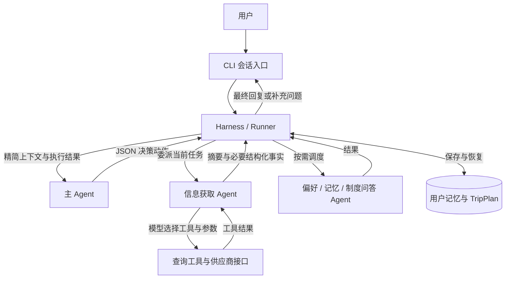
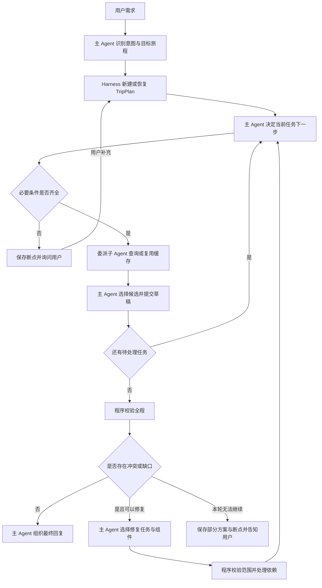
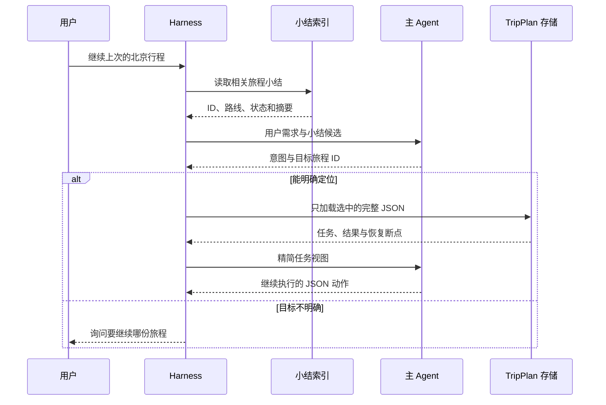

# 行程有据

基于 AgentScope 的命令行差旅助手，支持出行查询、用户偏好管理、差旅制度问答，以及多目的地旅程的规划、修改和恢复。

**主 Agent 做决策，子 Agent 获取信息，Harness 校验并执行，TripPlan 保存旅程安排与执行进度。**

[核心能力](#核心能力) · [系统架构](#系统架构) · [旅程流程](#旅程流程) · [记忆与上下文](#记忆与上下文) · [快速开始](#快速开始)

## 核心能力

- **多段旅程规划**：按路线拆分任务，安排火车与酒店地点建议，检查日期和路线衔接；未明确取消返程时，默认考虑返程。
- **局部修改与冲突协调**：修改指定路段，保留有效结果，处理受影响的后续任务并重新校验全程。
- **跨会话恢复**：根据旅程小结定位已有安排，恢复任务和断点，继续补充或修改。
- **偏好、历史与制度问答**：保存长期偏好，查询个人历史，通过本地知识库回答差旅制度问题。

## 系统架构

主 Agent 根据上下文输出结构化 JSON 动作；Harness / Runner 校验后执行，再把精简结果交回主 Agent。旅程编排采用状态机，任务 ID、版本和状态由程序管理。



| 角色 | 职责 |
| --- | --- |
| 主 Agent | 识别意图、拆分旅程、选择候选、协调冲突、组织回复 |
| 信息获取 Agent | 整理当前条件，调用火车、酒店等工具，检查或补查后返回摘要 |
| 偏好 Agent | 提取长期偏好更新，区分长期偏好与临时要求 |
| 记忆查询 Agent | 查询用户偏好和历史旅程 |
| 制度问答 Agent | 检索本地知识库，根据资料回答 |
| Harness / Runner | 动作校验、任务调度、状态流转、候选缓存、断点保存与全程校验 |

**ReAct 体现在信息获取子 Agent 内部**：模型决定工具和参数，程序执行工具，模型根据返回结果继续判断、补查或总结。每次委派使用独立上下文，主 Agent 接收摘要和必要事实，子 Agent 的完整工具对话不进入主会话历史。

## 旅程流程

一份 **TripPlan** 表示一趟旅程，其中每个 task 表示一段路线。例如“杭州 → 北京 → 上海 → 杭州”会形成三个有依赖的任务。每段任务保存条件、目标、查询结果、草稿和状态。TripPlan 是持久化的旅程业务对象，工作流是 Harness 推进任务的执行过程。当前代码仍使用 `workflow` 和 `workflows/`，后续重命名将统一采用 `TripPlan`、`trip_plan_id` 与 `trip_plans/`。



图中展示常见规划路径；实际由主 Agent 逐步选择动作，满足条件时可以复用已有结果。程序验证候选引用、版本和用户明确指定的条件，模型不能直接绕过检查宣布完成。

跨段冲突时，主 Agent 可以选择需要重做的旧 task；程序处理受影响的依赖，保留无关的有效组件，修复后重新校验全程。

## 记忆与上下文

长期记忆保存用户画像、偏好和旅程；短期记忆保存会话摘要及尚未压缩的主会话消息。本次日期、人数和预算等临时要求保存在旅程条件中，不自动成为长期偏好。

### 渐进式披露与恢复

完整 TripPlan 保存业务数据，模型接收的是精简视图。定位旅程先读独立的小结索引，选中后才加载对应完整 JSON；正常定位不会遍历读取所有完整旅程。



处理任务时，主 Agent 接收任务概览、当前条件、子 Agent 摘要和必要候选字段。网址、原始接口数据和重复字段留在存储中；候选按页披露，已有查询缓存可以复用。小结选择可以与意图识别在同一次模型请求中完成，不固定为三次调用。

主会话按 token 预算触发历史压缩，切点位于完整用户轮次之间。子 Agent 每次委派重新组装上下文，不继承上次调用的对话历史。

会话事件、恢复状态和运行观测分别保存在 `events.jsonl`、`state.json` 和 `runs.jsonl`。日志不直接充当提示词，用户数据按身份隔离。资源预算、超时和熔断保护限制反复执行，具体参数留在开发文档中。

## 快速开始

需要 Python 3.11，在仓库根目录执行：

```powershell
python -m venv .venv
.\.venv\Scripts\Activate.ps1
python -m pip install -r requirements.txt
Copy-Item .env.example .env
```

首次运行时创建 `.env`，已有配置请保留。设置 `LLM_API_KEY`、`LLM_BASE_URL` 和 `LLM_MODEL`；酒店地点与火车接口密钥分别为 `AMAP_API_KEY` 和 `JUHE_TRAIN_API_KEY`。

```powershell
python cli.py
```

按提示填写用户身份和常住城市，然后输入需求：

> 从杭州去北京待两晚，再去上海待一晚，安排火车和酒店。
>
> 继续上次的北京行程，把第二段改到周五。
>
> 以后酒店优先选全季。

常用命令：`help`、`history`、`resume`、`preferences`、`status`、`health`、`exit`。`resume` 恢复会话，自然语言请求可以定位并继续已有旅程。

制度问答使用 `.claude/skills/ask-question/data/documents/` 下的演示资料。准备本地嵌入模型后，运行 `python .claude/skills/ask-question/script/init_knowledge_base.py` 初始化知识库。

## 当前边界

当前规划主要提供火车与酒店地点建议，不执行购票、订房或景点活动安排；酒店地点查询不提供房价、空房和退改承诺。现有生产火车接口尚不可用，模拟测试的数据不代表真实可购买的票或房间。

## 开发与文档

运行离线回归测试：

```powershell
python -m pytest -q
```

| 目录 | 内容 |
| --- | --- |
| `agents/` | 主 Agent、Harness、状态机、上下文投影与冲突修复 |
| `.claude/skills/` | 专业子 Agent 实现与能力指南 |
| `travel_data/` | 查询工具、供应商接口与候选缓存 |
| `context/` | 用户记忆、会话存储、旅程索引与资源计量 |
| `tests/` | 离线回归测试 |

[正式行为规格](openspec/specs/) · [开发说明](docs/development/2026-10-12-follow-up-context-and-workflow.md) · [验证记录](docs/superpowers/reviews/2026-10-12-compact-travel-context-verification.md)
