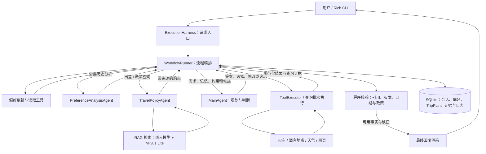
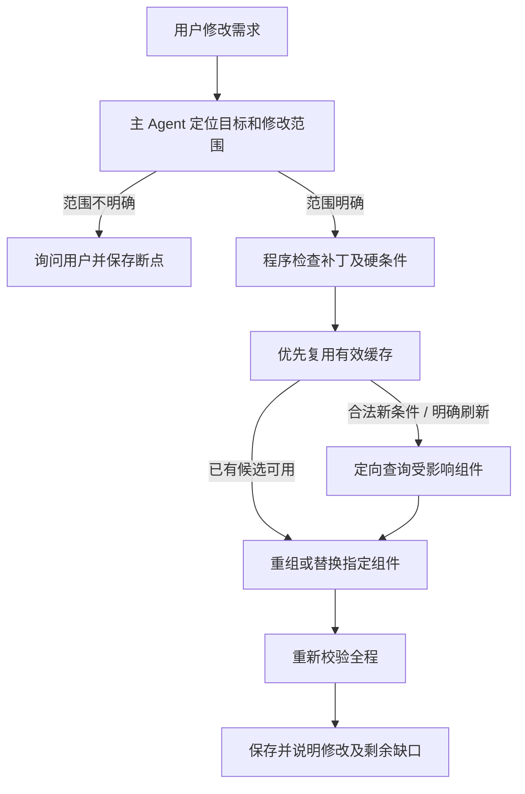

# 行程有据 · Trip Evidence Agent

一个基于 Python 和大语言模型的命令行出行助手，支持多城市火车与住宿规划、企业差旅政策约束、条件性偏好记忆，以及已有行程的查询、修改和恢复。

系统以**主 Agent 做决策、程序编排执行、查询结果提供证据、TripPlan 保存状态**为核心。大模型负责理解需求和选择方案，程序负责调用接口、控制并发、校验引用与约束、维护版本和持久化。

[功能](#功能) · [架构](#架构) · [规划与修改](#规划与修改) · [状态与数据](#状态与数据) · [快速开始](#快速开始) · [开发](#开发)

## 功能

- **多段出行规划**：按城市顺序拆分路段，为需要住宿的路段安排酒店地点建议，检查交通、入住、离店和后续路段的衔接；未明确要求单程时默认考虑返程。
- **局部修改**：定位用户指定的路段和组件，替换酒店、调整日期或修改路线，优先复用已有证据，保留未受影响的安排。
- **出差政策检索**：从本地企业资料中检索政策，提取带来源、适用范围和生效信息的约束，参与行程校验。
- **长期偏好记忆**：保存用户明确表达的条件性偏好；符合条件时低频分析历史行程，形成可增量更新的自然语言记忆。
- **历史查询与恢复**：通过行程索引定位 TripPlan，查看细节和候选，继续未完成的规划或修改已有方案。
- **独立信息查询**：通过工具查询火车、酒店地点、天气和网页信息；攻略查询可返回参考链接。
- **运行观测**：记录模型阶段、调用次数、输入/输出 token、耗时、工具结果和异常，支持回放与评估。

可以用自然语言表达需求：

```text
从重庆出发，明天去上海住两晚，再去杭州住一晚，最后回重庆，安排火车和酒店。
这是出差，按公司的差旅政策安排，必须周五上午到上海。
把上海那段的酒店换一家，火车和杭州的安排保持不变。
以后出差都尽量选择高铁，酒店优先考虑全季。
查看上次上海行程的返程候选，不用重新查询。
```

## 架构

当前请求流程由 `WorkflowRunner` 统一控制。`ExecutionHarness` 提供兼容入口，主 Agent 返回结构化决定，工具和存储层负责执行及保存。政策理解和历史偏好分析由专门 Agent 按需完成。



### 模块职责

| 模块 | 职责 |
| --- | --- |
| `MainAgent` | 识别意图、定位新旧旅行、生成完整任务提案、选择候选、判断冲突、提出局部修改或澄清问题 |
| `WorkflowRunner` | 前置资料协调、模型调用、查询计划绑定、任务调度、状态推进、局部修复、保存与恢复 |
| `ExecutionHarness` | 提供统一请求入口，将当前主流程交给 Runner |
| `ToolExecutor` / 批次执行 | 参数校验、缓存复用、依赖与并发控制、超时处理、接口调用、数据规范化和结果收集 |
| `TravelPolicyAgent` | 检索政策、理解条款、提取结构化约束，并保留来源、适用范围和缺口 |
| `PreferenceAnalysisAgent` | 依据有效历史行程低频总结软偏好，保存历史证据引用 |
| 偏好与记忆工具 | 直接读取、增加、替换或撤回长期记忆，不为普通读写调用模型 |
| `MemoryManager` / SQLite 存储 | 管理用户与会话、长期记忆、行程索引、完整计划、查询证据和运行观测 |
| 程序校验与回复层 | 根据引用重建所选事实，校验全程，输出具体安排、未知项和冲突说明 |

专业检索服务通过技能注册器按需加载。`information_query` 及旧偏好、记忆 Agent 的实现仍保留，但当前主流程不调度它们；查询由工具执行，偏好分析与政策提取使用各自专门流程。

### Agent、工具与程序的边界

主 Agent 输出任务、候选引用和修改决定。任务 ID、状态、版本和执行记录由程序生成及推进；模型不能靠改写这些字段绕过校验。

工具返回查询结果及来源。接口未提供的房价、库存或时刻保持未知；成功但没有候选、接口失败、条件筛除和证据过期分别处理。模型不将当前查询范围等同于整个市场，也不靠反复调用同一个接口补齐它没有的能力。

候选选择使用 `query_id`、`result_revision` 和 `candidate_id` 引用证据。程序验证任务归属与版本，重建交通、住宿和费用，再生成用户可读回复。

火车与酒店候选默认每页展示 5 条。首批候选不合适且有效缓存还有后页时，主 Agent 可以在提交方案前自主读取下一页；程序验证查询条件、任务版本及偏移，直接读取本地缓存，不增加供应商请求。排序和每页条数保持不变，前页有效候选仍可用于最终方案。高德目前只获取接口第 1 页、最多 25 条地点，本地翻页不会继续抓取接口后页；全部读取仍受模型决策与时间上限约束。

## 规划与修改

### 一次完整规划

1. **处理前置信息**：优先执行明确偏好更新，再读取当前记忆；需要出差政策时检索并提取适用约束。
2. **生成任务提案**：主 Agent 识别路线、日期、住宿时长及硬软条件，一次提出所有路段。缺住宿时长时给出有来源的建议，用户固定安排保持不变。
3. **准备查询**：程序创建 TripPlan 和任务，将火车、酒店等查询绑定到相应任务、版本及条件。
4. **执行查询**：满足依赖的独立请求可以并行；结果进入完整缓存，程序向模型提供有界候选。
5. **批量选择**：主 Agent 根据候选、偏好和政策提交方案；无法确定的事实保留缺口。
6. **校验与保存**：程序检查引用、时刻、住宿衔接、金额及政策，保存计划并渲染最终答复。

通常完整的新旅行使用“提案生成 → 批量选择”两次主模型调用。政策提取、首次历史偏好分析、无效输出修正和实际冲突处理可能增加调用；系统不把两次设为所有请求的固定上限。

### 用户修改已有旅行

修改先定位 TripPlan、路段和组件。例如“上海酒店换一家，火车不变”只影响上海住宿。程序优先在有效缓存中筛选和重组，必要时才执行受影响的新查询，然后重新校验全程。



日期和住宿时长分别记录来源及强度：`field_sources` 说明条件从哪里来，`condition_strengths` 的 `hard` / `soft` 说明能否调整。用户说“最好周五去”和“必须周五到达”具有不同约束，来源为用户也不自动等于强制。

- **软条件存在实际冲突**：主 Agent 可以提出合理的新日期，协调去程、住宿和返程；程序只查询受影响的新日期。
- **固定条件确认不兼容**：说明冲突及可放宽的安排，等待用户选择，保留可恢复状态。
- **接口失败或字段未知**：保留其他可用部分，如酒店地点和暂定返程，明确说明未核实项。

## 状态与数据

### TripPlan 与三层状态

TripPlan 是持久化旅行对象，包含有序路段 `tasks`、查询容器、完整查询结果、候选引用、执行记录、校验结果和恢复断点。代码中部分模块仍使用 `workflow` 命名。

每个路段默认需要火车查询容器，需要住宿时再增加酒店容器。程序管理任务和结果版本；条件改变后，受影响引用失效，历史证据仍可保留。

| 层级 | 状态 | 含义 |
| --- | --- | --- |
| TripPlan | `running` / `completed` | 旅行仍需处理 / 当前计划通过完整校验 |
| task | `pending` / `draft` / `validated` | 待处理 / 已有查询或选择草稿 / 当前版本校验通过 |
| 查询容器 | `empty` / `ready` / `failed` | 没有当前有效绑定 / 已有有效查询结果 / 查询失败 |

`ready` 不保证存在可选候选；成功空结果仍需进一步判断。`draft_stage` 区分查询草稿与选择草稿，缺输入、等待依赖和在途请求由断点、条件及执行记录派生。暂停、取消和异常通过停止原因记录。

用户收到的本轮结果可以是 `partial`，而 TripPlan 仍保持 `running`：例如去程失败，但酒店和返程已有建议。`completed` 表示计划校验通过，不表示已经购票、订房或实际完成旅行。

### 偏好与企业政策

长期偏好保存为可增量更新的自然语言记忆，例如：

```text
出差时尽量选择高铁；若高铁无法满足必须到达的时间，可考虑其他可行安排。
旅游住宿优先考虑靠海的位置，但不要求每次都满足。
```

用户明确表达“以后……”等长期要求时直接保存；读取、更新和撤回无需模型重新总结。一次旅行的日期、人数和临时预算保存在任务条件中。

历史偏好分析首次在累计至少三份有效已完成计划、且进入相应规划流程时触发；模拟、取消、异常等记录不作为有效样本。首次总结后不在每轮重复分析，用户明确要求重新总结时才再次触发。历史推荐和政策强制选择不能直接当作用户偏好。

政策流程是“检索资料 → 模型理解 → 结构化约束 → 来源与适用性校验”。结果包含约束、适用范围、引用、生效信息、缺失字段和冲突。**偏好是软约束；已确认适用的政策及用户硬条件不能自动放宽。** 无出差信息时，不自行套用企业身份和政策金额门槛。

### 上下文与渐进披露

系统先通过轻量行程索引定位目标，再加载选中的完整 TripPlan；主 Agent 接收任务概览、相关记忆、约束和有界候选。火车、酒店默认每页最多五条，完整结果保存在缓存中，可以按需继续读取。

查看已保存行程和候选采用只读通道，支持分页或分批展示全部结果，不推进计划状态、不重新查询供应商。历史对话通过会话摘要与近期主消息按预算组装，原始运行日志不直接塞入提示词。

### 存储与可观测性

每个用户的数据位于 `data/memory/user_<身份哈希>/agent.sqlite3`，由 SQLite 保存会话、偏好、TripPlan、索引、查询证据、事件和运行记录。完整计划与小结同事务更新，版本校验保护旧状态，用户之间按存储目录隔离。

模型观测记录调用阶段、输入/输出 token、耗时及首段响应时间；工具执行记录请求、结果、缓存命中和失败原因。可选单价用于估算费用，实际 token 以模型返回的 usage 为依据。

旧文件数据在首次访问时迁移，源文件保留，迁移后以 SQLite 为权威存储。备份与恢复方式见[存储说明](docs/development/2026-10-12-sqlite-storage-validation.md)。

## 快速开始

### 1. 安装

使用 Python 3.11，在仓库根目录执行。Windows PowerShell：

```powershell
python -m venv .venv
.\.venv\Scripts\Activate.ps1
python -m pip install -r requirements.txt
```

macOS / Linux 的虚拟环境激活命令为 `source .venv/bin/activate`，随后使用相同的安装和启动命令。

### 2. 配置

首次配置时复制示例文件，已有 `.env` 请保留：

```powershell
Copy-Item .env.example .env
```

| 配置项 | 用途 |
| --- | --- |
| `LLM_API_KEY` | 模型服务密钥 |
| `LLM_BASE_URL` | OpenAI 兼容模型服务地址 |
| `LLM_MODEL` | 对应服务支持的模型名称 |
| `JUHE_TRAIN_API_KEY` | 聚合火车查询授权密钥 |
| `AMAP_API_KEY` | 高德 Web 服务密钥，用于酒店地点搜索 |
| `MEMORY_CONTEXT_BUDGET_TOKENS` | 模型上下文预算；默认值见 `.env.example` |
| `LLM_INPUT_USD_PER_1M_TOKENS` / `LLM_OUTPUT_USD_PER_1M_TOKENS` | 可选费用估算单价 |

模型使用 OpenAI Python SDK 适配。未配置供应商密钥或供应商查询失败时，程序会说明对应证据缺口。

### 3. 启动和对话

```powershell
python cli.py
```

按提示输入用户 ID 和长期居住城市，再输入旅行需求。首次启动建立新会话；`resume` 用于选择恢复历史对话。常住城市用于缺出发地时的可靠默认值，可以后续更新。

| 命令 | 用途 |
| --- | --- |
| `help` | 查看帮助与示例 |
| `history` | 查看历史行程 |
| `resume` | 选择并恢复历史对话 |
| `preferences` | 查看偏好 |
| `preferences set 类型 值` | 设置偏好 |
| `preferences delete 类型` | 删除指定偏好 |
| `status` | 查看当前状态和记忆 |
| `health` | 检查模型服务 |
| `clear` | 清空当前任务，保留长期记忆 |
| `exit` | 退出 |

### 4. 准备政策知识库

企业资料放在 `.claude/skills/ask-question/data/documents/`，当前初始化脚本读取其中的 `.txt` 文档。仓库包含演示资料；用于自己的企业时，应替换为相应政策。

嵌入模型默认路径在 `config.py` 的 `RAG_CONFIG` 中，为 `data/models/bge-small-zh-v1.5`。准备本地模型后，初始化知识库：

```powershell
python .claude/skills/ask-question/script/init_knowledge_base.py
```

检索使用 Sentence Transformers 和 Milvus Lite。缺少本地模型时，实现可能尝试联网下载。Windows 中文路径环境可以在初始化和运行前设置同一个 ASCII 存储路径：

```powershell
$env:V0_RAG_DB_DIR = 'C:\trip-evidence-rag'
```

## 能力范围

当前主要生成火车与酒店地点安排，不执行购票、订房、支付或退改签，也不自动生成详细景点活动日程。攻略或网页链接用于参考。

高德酒店查询返回名称、地址、位置及部分地点信息，不能证明指定日期的房型、房价、空房或退改规则。存在硬报价或政策金额要求时，这些缺口会如实保留。

火车候选的时刻、票价和余票取决于授权接口当次返回；查询时有票不等于已经预订。天气仅能使用接口提供的日期范围。模拟评估的车次、地点、报价和库存均用于测试，不代表真实可购买资源。

## 开发

### 目录

```text
agents/            主 Agent、政策/偏好分析、流程调度、状态与校验
travel_data/       工具契约、供应商适配、批次执行、缓存与候选视图
context/           会话、长期记忆、SQLite、上下文预算与运行计量
utils/             JSON 解析、最终回复、服务容错及辅助工具
.claude/skills/    按需加载的检索服务、能力指南及保留实现
tests/             离线回归与接口形状测试夹具
evals/             模型与系统评估脚本
docs/              架构说明、开发文档和验证记录
openspec/          正式行为规格与变更归档
cli.py             命令行入口
config.py          应用与模型配置
```

### 测试与评估

安装测试依赖并运行离线回归：

```powershell
python -m pip install pytest pytest-asyncio
python -m pytest -q tests
```

测试覆盖任务状态、查询依赖与并发隔离、候选与版本引用、硬软条件、政策约束、局部修改、只读查询、跨会话恢复和存储事务。CI 使用 Python 3.11 运行回归及密钥模式检查。

`evals/` 中部分脚本会调用配置的真实模型或外部服务，可能产生费用；执行前查看具体脚本的场景、模拟范围及调用上限。真实模型、模拟供应商和真实供应商结果应分别标记，评估同时检查最终回答的事实、完整度和缺口，不仅检查 JSON 是否合法。

[行为规格](openspec/specs/) · [开发说明](docs/development/2026-10-12-follow-up-context-and-workflow.md) · [验证记录](docs/superpowers/reviews/) · [评估报告](docs/evals/)
