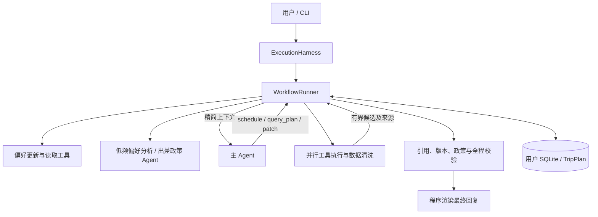
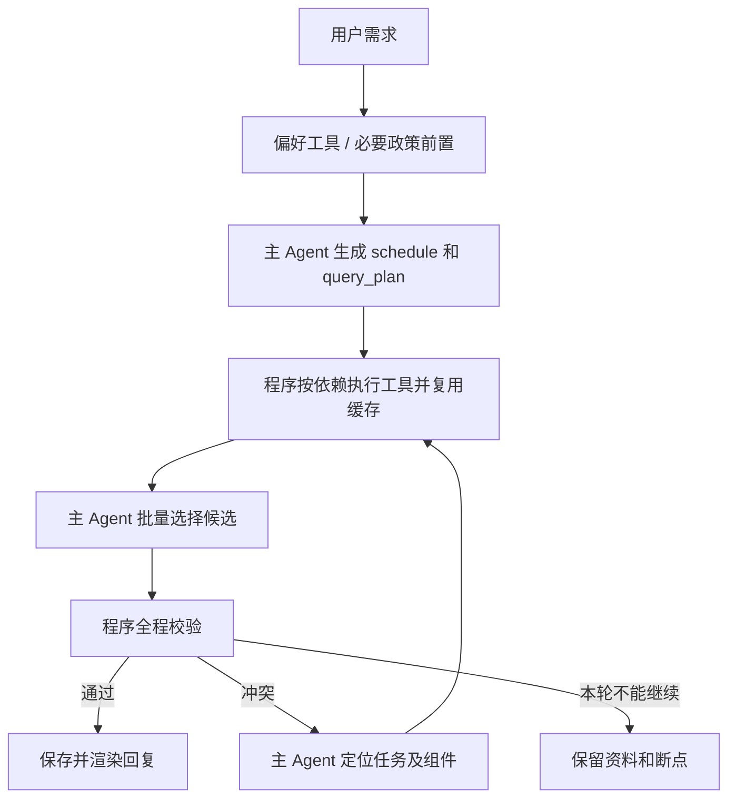

# 行程有据

基于项目 Agent 内核与 OpenAI 官方 SDK 的命令行差旅助手，支持出行查询、用户偏好管理、差旅制度问答，以及多目的地旅程的规划、修改和恢复。

**主 Agent 规划与判断，程序执行查询与校验，TripPlan 保存旅程安排与执行进度。**

[核心能力](#核心能力) · [系统架构](#系统架构) · [旅程流程](#旅程流程) · [记忆与上下文](#记忆与上下文) · [快速开始](#快速开始)

## 核心能力

- **多段旅程规划**：按路线拆分任务，安排火车与酒店地点建议，检查日期和路线衔接；未明确取消返程时，默认考虑返程。
- **局部修改与冲突协调**：修改指定路段，保留有效结果，处理受影响的后续任务并重新校验全程。
- **跨会话恢复**：根据旅程小结定位已有安排，恢复任务和断点，继续补充或修改。
- **偏好、历史与制度问答**：保存长期偏好，查询个人历史，通过本地知识库回答差旅制度问题。

## 系统架构

WorkflowRunner 控制整个请求：先处理偏好与必要政策，再让主 Agent 一次生成任务和查询安排；程序执行独立工具、清洗结果、维护状态；主 Agent 批量提交选择，程序校验并生成最终回复。ExecutionHarness 是兼容入口。



| 角色 | 职责 |
| --- | --- |
| 主 Agent | 识别意图和目标、生成任务安排、批量选择候选、判断冲突与局部修复 |
| 偏好工具 | 原文增量保存、定向更新/撤回、读取偏好和历史；不调用模型 |
| 偏好分析 Agent | 首次累计三份有效行程时总结一次；以后仅明确要求重新分析时调用 |
| 政策 Agent | 继承 RAG 检索，理解政策并直接提取带来源的强制约束 JSON |
| WorkflowRunner | 前置协调、模型调用、任务调度、状态推进、局部修复、保存与恢复 |
| 工具执行层 | 接口调用、独立并发、超时、结果收集、无模型清洗及完整缓存 |

`information_query` 及旧偏好/记忆模型的代码保留；当前主流程不会调度它们。正常旅游回放是两次主模型调用，政策、首次偏好分析及实际冲突修复另计。

## 旅程流程

每份 TripPlan 包含多个路段 task；每段具有火车容器，需要住宿时另有酒店容器。任务 ID、版本及三层业务状态由程序管理。



| 层级 | 业务状态 |
| --- | --- |
| TripPlan | `running`、`completed` |
| task | `pending`、`draft`、`validated` |
| 查询容器 | `empty`、`ready`、`failed` |

`draft_stage` 区分查询草稿和选择草稿；`needs_input`、依赖等待与在途请求由字段和执行记录派生。暂停/取消通过停止原因保存；成功但没有候选，与接口失败分别处理。

修改先在完整有效缓存中按新条件筛选，只有受影响领域缺证据或需要刷新时才查接口。失败修改保留原有效方案；开始过但未确认完成的请求不会在恢复时自动重发。

## 记忆与上下文

长期偏好是一组可增量的条件性自然语言记忆；偏好是软约束，企业政策是强制约束。日期、人数和这次预算等临时条件保存在任务中。

正常定位先读取行程小结，再加载选中的完整 TripPlan。主 Agent 只接收任务概览、有界候选及必要来源，完整接口结果保存在缓存中；火车、酒店默认每页五条。已保存行程详情和候选支持只读分页与全部分批展示，不推进状态或查询供应商。

SQLite 保存会话、偏好、查询证据、模型与工具日志以及完整行程；行程和小结同事务提交，保留版本校验与用户隔离。旧文件仅用于迁移，运行日志不直接作为提示词。

实施边界及验证见 [开发文档](docs/development/2026-10-12-follow-up-context-and-workflow.md) 与 [验证记录](docs/superpowers/reviews/2026-10-13-consolidated-travel-verification.md)。

## 快速开始

需要 Python 3.11，在仓库根目录执行：

```powershell
python -m venv .venv
.\.venv\Scripts\Activate.ps1
python -m pip install -r requirements.txt
Copy-Item .env.example .env
```

首次运行时创建 `.env`，已有配置请保留。设置 `LLM_API_KEY`、`LLM_BASE_URL` 和 `LLM_MODEL`；酒店地点与火车接口密钥分别为 `AMAP_API_KEY` 和 `JUHE_TRAIN_API_KEY`。

```powershell
python cli.py
```

按提示填写用户身份和常住城市，然后输入需求：

> 从杭州去北京待两晚，再去上海待一晚，安排火车和酒店。
>
> 继续上次的北京行程，把第二段改到周五。
>
> 以后酒店优先选全季。

常用命令：`help`、`history`、`resume`、`preferences`、`status`、`health`、`exit`。`resume` 恢复会话，自然语言请求可以定位并继续已有旅程。

制度问答使用 `.claude/skills/ask-question/data/documents/` 下的演示资料。准备本地嵌入模型后，运行 `python .claude/skills/ask-question/script/init_knowledge_base.py` 初始化知识库。

## 当前边界

用户持久化数据保存在 `data/memory/<用户身份哈希>/agent.sqlite3`。SQLite 保存偏好、会话状态、事件、运行观测与完整行程；短期记忆仍在内存中，从摘要和未覆盖的主消息按需组装。行程与小结一起提交，事件追加使用独立序号和幂等约束，新最终回复只保存答复、必要事实和行程 ID/版本。

首次访问某个用户时自动迁移其旧 JSON/JSONL 数据；来源文件保留原字节，迁移失败不会进入业务执行，可排除原因后重试。迁移完成后只写数据库，不再同步旧文件。请停止旧版本程序后再启动新版；旧文件保留的是迁移前状态，直接运行旧版无法读到此后的更新。`trip.md` 是可重建导出，数据库才是权威状态。清空历史保留偏好；删除业务数据保留最小迁移标记，避免旧文件再次导入。

备份应使用 SQLite 的一致备份接口，不要在写入时直接复制数据库：

```python
from context.sqlite_storage import SQLiteStorage

storage = SQLiteStorage('data/memory', '你的用户ID')
storage.ensure_ready()
storage.backup_to('data/memory/backups/user-backup.sqlite3')
```

恢复时先停止程序，将备份替换到同一用户的数据库路径；先备份当前数据库。AgentScope 移除与只读行程详情已纳入本次整合；迁移原文件的后续清理仍按需处理。存储验证见 [改造记录](docs/development/2026-10-12-sqlite-storage-validation.md)。

当前规划主要提供火车与酒店地点建议，不执行购票、订房或景点活动安排；酒店地点查询不提供房价、空房和退改承诺。现有生产火车接口尚不可用，模拟测试的数据不代表真实可购买的票或房间。

## 开发与文档

运行离线回归测试：

```powershell
python -m pytest -q
```

| 目录 | 内容 |
| --- | --- |
| `agents/` | 主 Agent、Harness、状态机、上下文投影与冲突修复 |
| `.claude/skills/` | 专业子 Agent 实现与能力指南 |
| `travel_data/` | 查询工具、供应商接口与候选缓存 |
| `context/` | 用户记忆、会话存储、旅程索引与资源计量 |
| `tests/` | 离线回归测试 |

[正式行为规格](openspec/specs/) · [开发说明](docs/development/2026-10-12-follow-up-context-and-workflow.md) · [验证记录](docs/superpowers/reviews/2026-10-12-compact-travel-context-verification.md)
